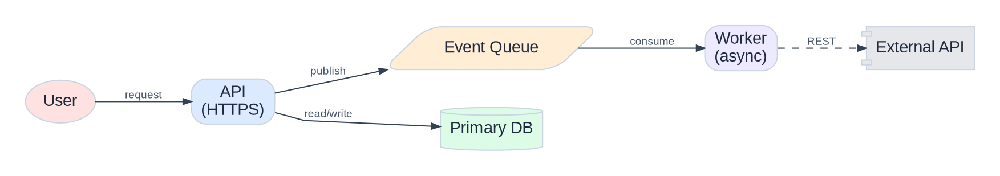

# Architecture diagrams

Use Graphviz for service relationships, system boundaries, APIs, queues, and
storage.

## Conventions

| Element | Shape | Fill |
|---|---|---|
| Human or caller | ellipse | `#FEE2E2` |
| Service | rounded box | `#DBEAFE` |
| Worker or batch job | rounded box | `#EDE9FE` |
| Database or cache | cylinder | `#DCFCE7` |
| Queue or event bus | parallelogram | `#FFEDD5` |
| External system | component | `#E5E7EB` |

Use clusters only for meaningful trust, ownership, network, or deployment
boundaries. Avoid decorative containers.

## Template

## Review checklist

- Dependency direction is accurate.
- Runtime relationships are not confused with build-time dependencies.
- Optional or inferred relationships are visually distinguished.
- Storage and queues are not rendered as generic services.
