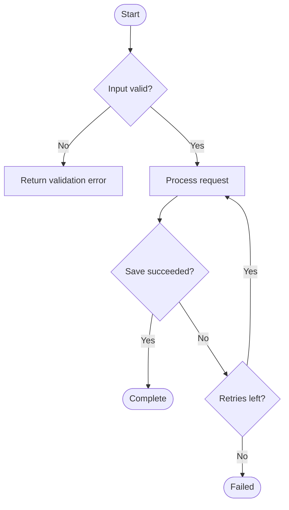

# Flowcharts

Use Mermaid for compact decision flows. Switch to Graphviz when the diagram
exceeds roughly 15 nodes or needs strict layout control.

- Use rectangles for actions, diamonds for decisions, and stadiums for
  start/end.
- Phrase decisions as questions and label every outgoing branch.
- Show meaningful error, timeout, retry, and fallback paths.
- Avoid translating every source line; diagram business-significant branches.
