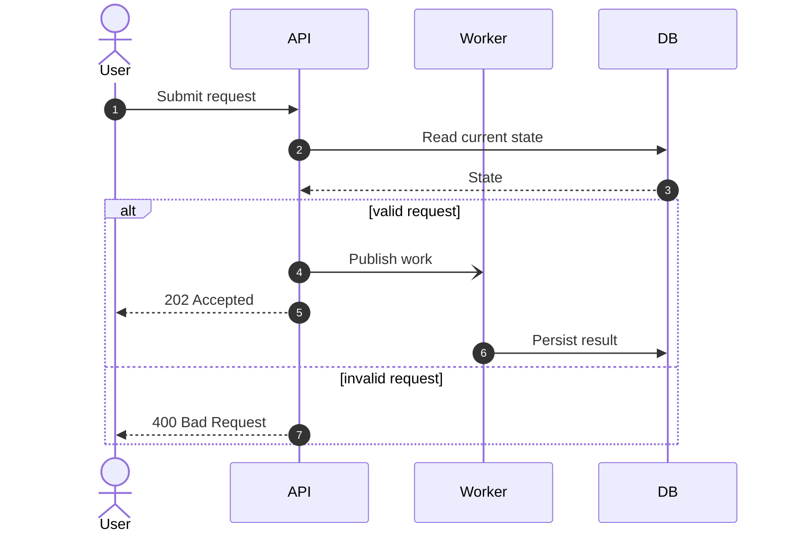

# Sequence diagrams

Use Mermaid to show an ordered request, event, or workflow across components.

- Keep participants to eight or fewer.
- Use `->>` for calls, `-->>` for responses, and `-)` for async messages.
- Use `alt`, `opt`, `loop`, and `par` only when they improve the story.
- Confirm response and error paths rather than showing only the happy path.
