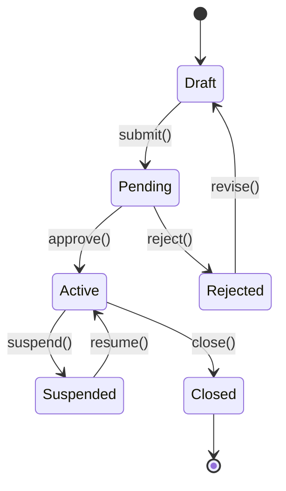

# State-machine diagrams

Use Mermaid `stateDiagram-v2` for lifecycle states, valid transitions, guards,
and terminal outcomes.

- Include explicit initial and terminal pseudo-states.
- Label transitions with the event and guards when needed.
- Use nested states only for meaningful sub-lifecycles.
- Check that every reachable nonterminal state has an exit.
